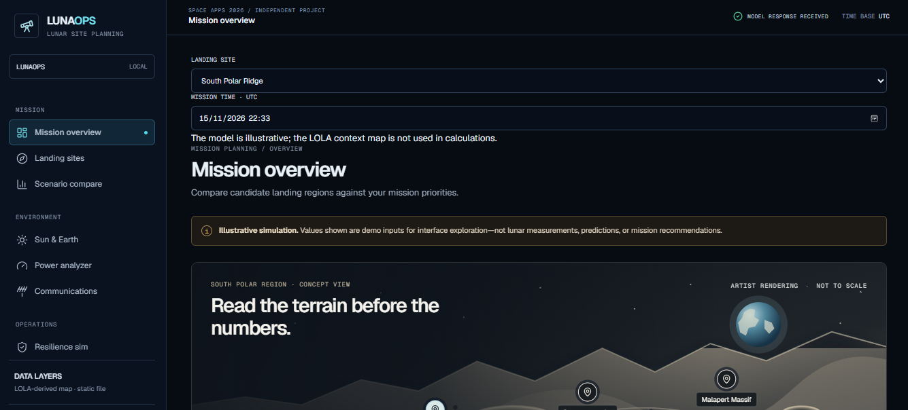
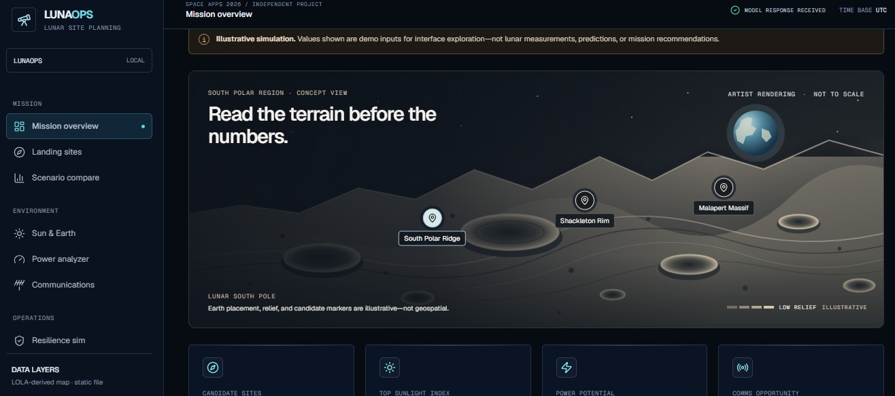
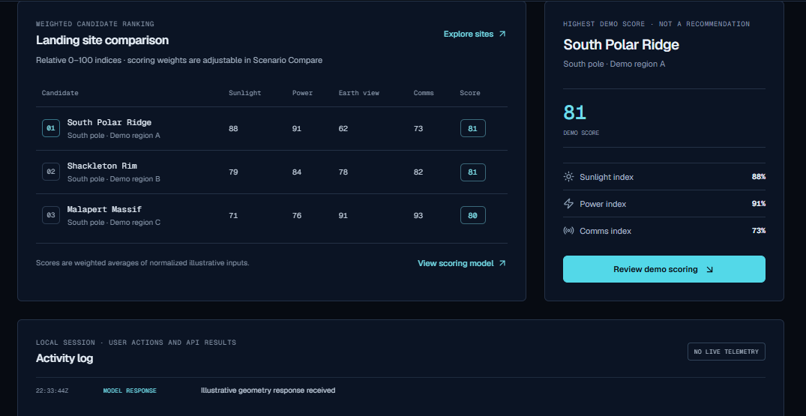
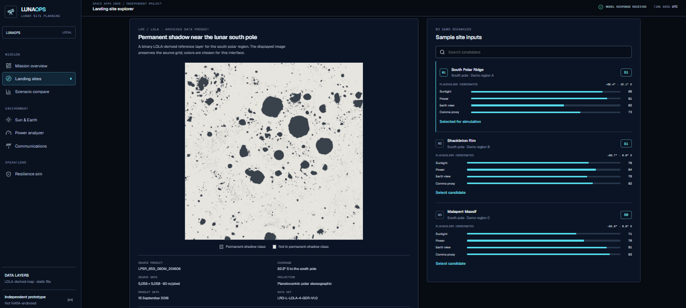
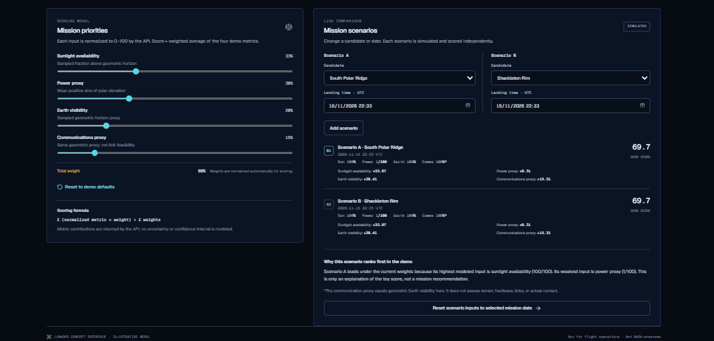

# LUNAOPS

**Lunar landing-site exploration for the 2026 NASA Space Apps Challenge**

LUNAOPS is an interactive prototype for comparing illustrative lunar south-pole landing-site scenarios. It brings candidate locations, lunar surface context, Sun/Earth visibility concepts, and weighted scenario comparisons into one dashboard.

- **Challenge:** [Lunar Landing Site Navigator](https://www.spaceappschallenge.org/2026/challenges/lunar-landing-site-navigator/?tab=details)
- **Source code and project files:** [GitHub repository](https://github.com/Salmaelbz/lunaops-space-apps-2026)
- **Live website:** Netlify configuration is included; a public URL is not available until the repository is deployed.

## Screenshots

| Mission overview | Terrain and metrics |
| --- | --- |
|  |  |

| Candidate ranking | Landing-site explorer |
| --- | --- |
|  |  |

| Scenario comparison |
| --- |
|  |

## What the prototype demonstrates

- Explore a lunar south-pole context map and compare illustrative candidate sites.
- View simplified Sun and Earth visibility timelines and power/communications indicators.
- Compare scenarios using adjustable, transparent scoring weights.
- See data provenance and model limitations alongside the visualizations.

## NASA data and attribution

The map includes a display-only, colorized derivative of the LRO Lunar Orbiter Laser Altimeter (LOLA) permanent-shadow product [`LPSR_85S_060M_201608.JP2`](https://imbrium.mit.edu/EXTRAS/ILLUMINATION/JP2/LPSR_85S_060M_201608.JP2). The source is hosted in the MIT LOLA archive; its [product label](https://imbrium.mit.edu/EXTRAS/ILLUMINATION/JP2/LPSR_85S_060M_201608_JP2.LBL) identifies it as an LRO/LOLA product. The archive warns that its `EXTRAS` products are not supported by PDS or the LOLA Science Team. The raster provides visual context only; it is not queried by the scoring or simulation.

The interface links to [NASA Moon Trek](https://trek.nasa.gov/moon/), [JPL Horizons](https://ssd.jpl.nasa.gov/horizons/), [NASA NAIF/SPICE](https://naif.jpl.nasa.gov/naif/), and the [NASA PDS Geosciences Node](https://pds-geosciences.wustl.edu/) as reference resources. It also links to [LROC QuickMap](https://quickmap.lroc.asu.edu/) and the [Canadian Space Agency's Moon exploration page](https://www.asc-csa.gc.ca/eng/astronomy/moon-exploration/). These links provide context only; none supplies live data to the current model. LUNAOPS is an independent prototype and is not affiliated with or endorsed by NASA, MIT, PDS, the LOLA Science Team, or the Canadian Space Agency.

## Important limitations

This is a hackathon concept, not a mission-planning or landing-safety tool. Candidate coordinates and rankings are illustrative. The backend uses simplified, unvalidated geometry approximations; it does not retrieve ephemerides or model detailed terrain obstruction, power yield, RF link budgets, relay availability, or uncertainty. Scores and indicators are not scientific measurements or operational recommendations.

## Technology

React, TypeScript, and Vite power the frontend. A Python/FastAPI API supports local development; Netlify Functions provide the simulation and scoring endpoints for the hosted static site.

## Run locally

Install the JavaScript dependencies, then start the frontend:

```sh
npm install
npm run dev
```

In a second terminal, start the API:

```sh
cd backend
python -m venv .venv
```

Activate the virtual environment, install the requirements, and run the API:

```sh
pip install -r requirements.txt
uvicorn main:app --reload --host 127.0.0.1 --port 8000
```

## Publish on Netlify

Import `Salmaelbz/lunaops-space-apps-2026` from GitHub and deploy with the settings in [`netlify.toml`](netlify.toml). The build command is `npm run build`; the publish directory is `dist`. The included Netlify Functions handle `/api/v1/simulate` and `/api/v1/score`. A public Netlify URL will be created after deployment.

## AI assistance

For this update, a generative AI assistant helped prepare the Netlify deployment configuration and JavaScript API functions and edit this README. The screenshots in this gallery were supplied by the team and copied without alteration; no AI-generated images or video were added in this update.
